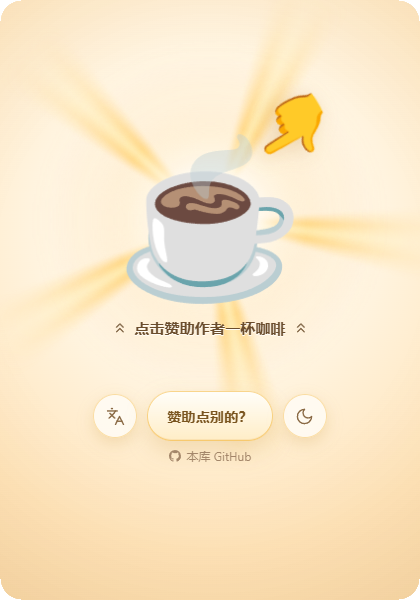
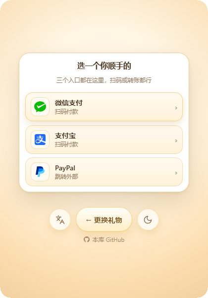
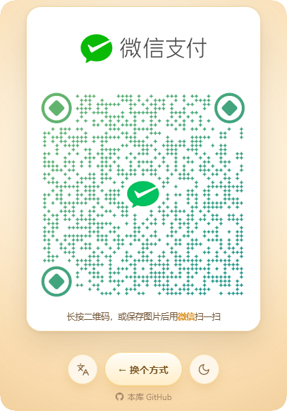
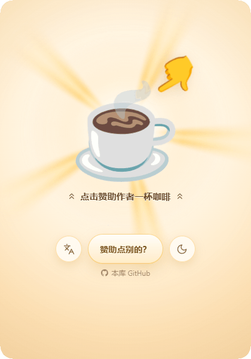
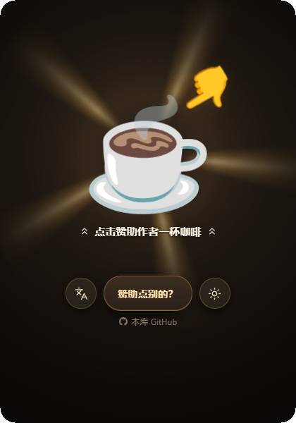
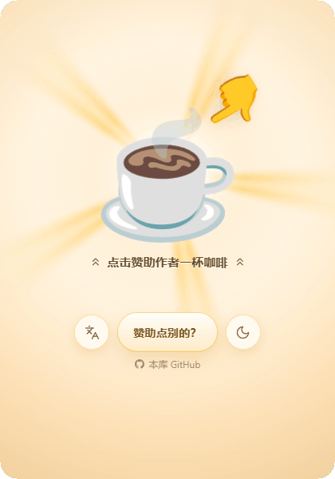
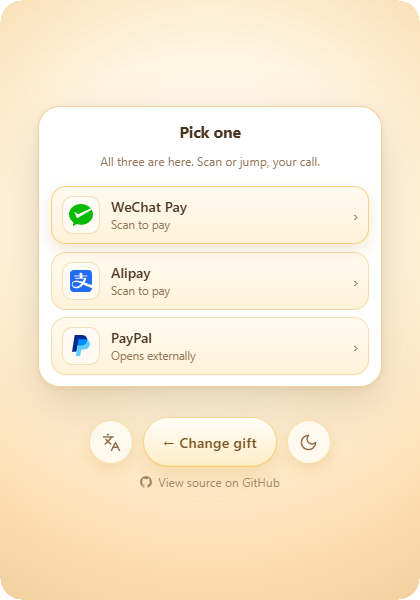
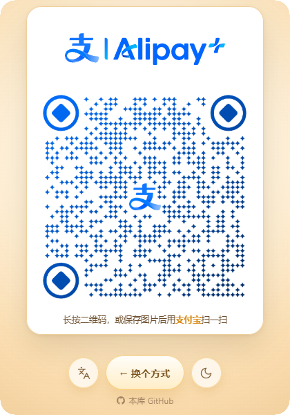
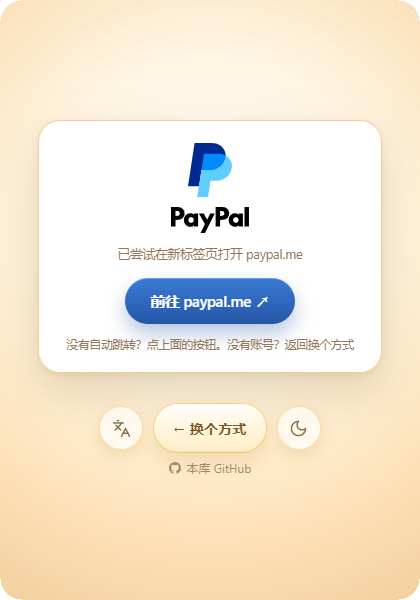

<div align="center">
    <h1>sponsor-me</h1>
    <p>A build-free single-page sponsor page · light &amp; dark themes · Chinese &amp; English · WeChat Pay / Alipay / PayPal</p>
    <p><a href="README.md">中文</a> | <b>English</b></p>
    <p>
        <a href="https://github.com/JH0531/sponsor-me/blob/main/LICENSE"></a>
        <a href="https://github.com/JH0531/sponsor-me/graphs/contributors"></a>
        <a href="https://github.com/JH0531/sponsor-me/releases"></a>
        <a href="https://github.com/JH0531/sponsor-me/stargazers"></a>
        <a href="https://www.jsdelivr.com/package/gh/JH0531/sponsor-me"></a>
    </p>
</div>

## Demo

### Three screens

Landing, channel picker and payment card all live in the same page — no router, no navigation, no reload.

<p align="center">
    
    
    
</p>

### Switching gifts

Tap "Sponsor something else?" to pick another gift; the animation and its caption change together.

<p align="center"></p>

### Light & dark themes

Chosen automatically from the system preference, or switched manually with the button at the bottom right. Switching unfolds a circular mask centred on that button.

<p align="center">
    
    
    
</p>

### Chinese & English

Captions, gifts, danmaku, channel names and accessibility labels all follow the language. Every `zh-*` tag resolves to Simplified Chinese; everything else falls back to English.

<p align="center">
    
    
    
</p>

### Payment channels

WeChat Pay and Alipay show a QR code. PayPal opens an external link while the page keeps a card behind, so it is easy to come back if the tab did not open or you have no account.

<p align="center">
    
    
    
</p>

### Full journey

Landing → gift switch → language switch → theme switch → confetti → WeChat → Alipay → PayPal external link and return → back to landing.

<div align="center">
    <video src="https://github.com/user-attachments/assets/936af679-87d0-4795-a3c1-42c559bbdcfd" controls width="420" style="border-radius:10px"></video>
</div>

<p align="center"><a href="docs/demo/journey-v2.mp4">Full journey video</a></p>

## Features

- **One page, three screens**: landing / channel picker / payment card, switched by `data-state` + `channel`, no router
- **Vector animation**: Lottie from Noto Animated Emoji, crisp at any resolution
- **Light + dark themes, Chinese + English**: routed automatically from system preferences, manually switchable
- **Runs by double-clicking**: open `index.html` directly, no build step

## Quick start

```bash
# Just double-click index.html, or serve it statically:
python -m http.server 8000
```

## Configure one file

Everything lives in `assets/config.js`.

### 1. Payout info

```js
meta: {
  paypalUrl: 'https://paypal.me/<your ID>'
}
```

Replace the four files in `assets/qr/` (WeChat / Alipay × light / dark) with your own QR codes. Originals are 500×500; keep them square with a white margin.

### 2. Gift items

`media` is the media registry; keys are filenames and must be globally unique:

```js
media: {
  hero:  { file: 'coffee.json', kind: 'lottie', loop: 2017 },
  socks: { file: 'socks.json',  kind: 'lottie', loop: 2200 }
}
```

- `file` points at the raw Lottie JSON in `.media/lottie/` (not committed; see below)
- `kind` is always `'lottie'` for now
- `loop` is the duration of one cycle in milliseconds; the build script cross-checks it against the JSON's own `(op-ip)/fr`
- `trim` (optional) cuts the timeline at a given frame to remove trailing blank or duplicated loops

**You do not need to pick a rest frame.** Every Noto Lottie file carries a `rest` marker indicating where the author intended it to stop; the build script reads it and ships it alongside the animation as `window.__LOTTIE_REST__`. This matters: some animations start on an empty frame (🌈 / 🍦), some are sideways (🍪 at exactly 90°), and some begin as a single spark (🌟). Always stopping at frame 0 would freeze the picture somewhere unrecognizable.

`trim` is used in one place only — `cookie`'s timeline really does end in dead air:

| key | Problem | Fix |
| --- | --- | --- |
| `cookie` | Everything after frame 106 is blank, adding 200ms of empty screen | `trim: 106`, `loop: 1767` |

`rocket` looks like "the same segment played twice", but **do not trim it**: the exhaust, speed lines, and reflection are indeed 20-frame sub-comps placed twice in `comp_0` (`ip 0–20` and `20–40`), yet the hull and window shake is a 40-frame oscillation (centre → left → centre → right → centre). Trimming to 20 leaves only the one-sided shake and makes the loop point jump; on top of that, a 333ms cycle is too short for a "send a rocket" action. The full 40 frames = 667ms is the intended cycle.

`items` is grouped by language and matched across languages by `media` name:

```js
items: {
  'zh-Hans': [ { media: 'hero', caption: '点击赞助作者一杯咖啡', blurb: '' } ],
  'en':      [ { media: 'hero', caption: 'Tap to buy the author a coffee', blurb: '' } ]
}
```

Do not put arrow glyphs in `caption` — the `chevrons-up` icons on both sides are inserted by the renderer and inherit the text colour.

**Each language is independent.** To make a gift appear only in Chinese, simply leave it out of the `en` list. If the current item has no same-named entry after a language switch, the first item of the new language is used.

### 3. Danmaku & UI strings

`danmaku` is grouped by language; `i18n` holds button labels, hints and accessibility labels.

## Regenerate assets (optional)

```bash
node scripts/build-assets.mjs
```

Pure Node — no ffmpeg, no ImageMagick. The script reads `assets/config.js` and turns build inputs in `.media/` into runtime assets in `assets/`:

| Input (`.media/`, not committed) | Output (`assets/`, committed) |
| --- | --- |
| `lottie/*.json` | `lottie/<key>.js` — wrapped as `window.__LOTTIE__` registrations |
| `vendor/lottie_light.min.js` | `vendor/lottie_light.min.js` |
| `修改源材料/*.svg` | `brand/*.svg` |
| `修改源材料/*收款码*.png` | `qr/*.png` |

> Why Lottie ships as `.js` instead of `.json`: `lottie-web` loads `path` via XHR, which is blocked by CORS under `file://`. Loading it with `<script>` keeps double-click-to-run working.

### About `.media/`

This is a **local-only build input directory, excluded by `/.*/` in `.gitignore`** and never uploaded. It holds the raw Lottie JSON, channel brand SVGs, original QR code images, and a `sources.md` recording where each asset came from. To rebuild assets on another machine, restore this directory from `sources.md` first.

## External dependencies

| Dependency | Version | Purpose | License |
| --- | --- | --- | --- |
| [lottie-web](https://github.com/airbnb/lottie-web) | 5.12.2 (`lottie_light`, SVG renderer) | Plays Lottie animations, vendored in `assets/vendor/` | MIT |

No other runtime dependencies and no CDN requests. The build script uses only Node built-ins.

## Compatibility

Lottie renders through SVG, so behaviour is consistent across major browsers; there are no codec or alpha-channel branches. Animation data is loaded with dynamically injected `<script>` tags, so both `file://` and http work.

> The one difference: some browsers restrict `localStorage` more tightly under `file://`, so theme/language preferences may not persist and fall back to automatic detection from system preferences.

## Structure

```
index.html                Single entry point
README.md                 Chinese documentation
README-en.md              English documentation
assets/
  config.js               Media registry + i18n items + danmaku + channels + strings
  styles.css              Dual-theme tokens + layout + animations
  app.js                  Theme / language / Lottie / state machine / confetti / danmaku
  lottie/ vendor/ brand/ qr/ emoji/
docs/demo/                README demo assets
scripts/                  Asset build, demo capture, deploy sync
.github/workflows/deploy-sync.yml
LICENSE                   GPL-3.0
```

### State machine

| State | Trigger | Goes to |
| --- | --- | --- |
| `idle` | Tap the coffee | `launching` → `channel` after 2000ms |
| `idle` | Tap "Sponsor something else?" | `rolling` → back to `idle` after 900ms |
| `channel` | Pick a channel | Stays in `channel`, only the card changes |
| `channel` | Main button | Picker → back to `idle` (keeps the gift); QR card → back to picker |

The single main button at the bottom is reused: its label and action change with the state, which is why all three screens have exactly one. Every entry into the payout scene plays a fresh entrance animation — going back clears the card state, so no exit animation is replayed.

### Theme & language

- Theme: reads `prefers-color-scheme`, falling back to light. Manual switching uses a View Transitions circular mask centred on the button; unsupported browsers just swap.
- Language: all `zh-*` tags resolve to Simplified Chinese, everything else to English.
- Both are stored in `localStorage`; a manual choice always takes priority.

### The deploy branch

`deploy` is a pure deployment branch. Its allowlist contains only `index.html`, `assets/**` and `LICENSE`. README files, `docs/demo/`, scripts, `.github/`, the site verification file, and any file added to `main` in the future are excluded.

`deploy` keeps a linear history: every sync creates a child commit of the current deploy HEAD and pushes with a plain fast-forward; no commit is created when the content is unchanged.

```bash
node scripts/sync-deploy.mjs --dry-run    # print the list and assert
node scripts/sync-deploy.mjs --push       # create and fast-forward push
node scripts/sync-deploy.mjs --verify     # verify remote cleanliness
```

The script reads only the commit tree and assembles it with a temporary index outside the repository; it never touches the working tree, untracked files or stashes. `.github/workflows/deploy-sync.yml` syncs automatically when deployment-relevant files change on `main`.

| Change | Effect on deploy |
| --- | --- |
| `index.html` / `assets/**` | Synced automatically |
| README / `docs/demo/` | Excluded by default |
| New gift animation `assets/lottie/*.js` | Falls under `assets/**`, synced automatically |

To roll back, run `node scripts/sync-deploy.mjs --push --from <good-sha>`: it rebuilds the content from the given `main` commit but still uses the current deploy HEAD as parent, so history is never rewritten.

### Releases

`release` branches off `deploy` and acts as the manual publish gate. It has no commits of its own, so every sync is a fast-forward.

```bash
node scripts/sync-release.mjs --dry-run   # check whether a fast-forward is possible
node scripts/sync-release.mjs --push      # fast-forward release, triggering a publish
node scripts/next-version.mjs             # preview the next version
```

Running `--push` dispatches a publish event on the default branch; `.github/workflows/release.yml` then creates a tag and a GitHub Release with zip / tar.gz archives and SHA256SUMS. Version tags prefixed with `V` are the single source of truth: the initial version is `V0.1.0`, the third segment carries at 10 into the second, the second carries at 100 into the first, and the first has no limit. `workflow_dispatch` can preview with a dry run without publishing.

## Accessibility & fallbacks

- `prefers-reduced-motion`: disables rotation, confetti and scrolling danmaku in favour of a fixed line of text; tapping the coffee reaches the payout scene in 200ms
- Touch devices without hover: the coffee animation replays every 6 seconds
- All overlays use `pointer-events: none`, so QR codes remain long-pressable

## Credits

- [qr-merger/merger](https://github.com/qr-merger/merger) — a lightweight integrated QR payment page for WeChat, Alipay and PayPal with multilingual support; the channel-merging idea here comes from it.
- [kimi360/Docker-Sponsor-Page](https://github.com/kimi360/Docker-Sponsor-Page) — a Docker image with Alipay / WeChat sponsor buttons, offering flip-card and "buy me a coffee" styles; the card interaction here is inspired by it.

## License

The project code is released under the **GNU General Public License v3.0**; see [LICENSE](LICENSE) for the full text.

### Animation assets

The emoji animations come from **[Noto Animated Emoji](https://googlefonts.github.io/noto-emoji-animation/)** (Google), used under **[CC BY 4.0](https://creativecommons.org/licenses/by/4.0/)**. They live in `assets/lottie/`, built from the raw JSON in `.media/lottie/`, with no changes to the artwork.

> Noto Animated Emoji © Google, licensed under CC BY 4.0.

Emoji used (33 in total):

| Group | Emoji |
| --- | --- |
| Entrance & gesture | ☕ 👇 |
| Affection | 💝 💋 💐 🎈 🌈 🍀 🌟 |
| Food & drink | 🍻 🧋 🍹 🍪 🍦 🍗 🔥 |
| Rewards | 🏆 🥇 💯 💎 🪙 💸 |
| Playthings | 🎰 🔮 🪄 🛸 🏠 🚀 |
| Others | 💣 👻 💡 📣 🧦 |

### Channel marks

The WeChat Pay, Alipay and PayPal marks in `assets/brand/` remain the property of their respective rights holders. They are used solely to identify the corresponding payment channels and imply no affiliation or endorsement.

### Third-party library

`assets/vendor/lottie_light.min.js` is the official [lottie-web](https://github.com/airbnb/lottie-web) build, used under MIT; its original copyright notice is preserved inside the file.
