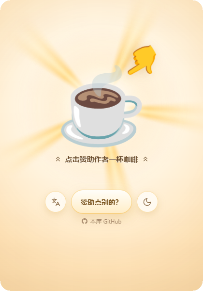
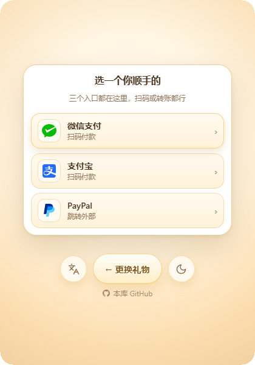
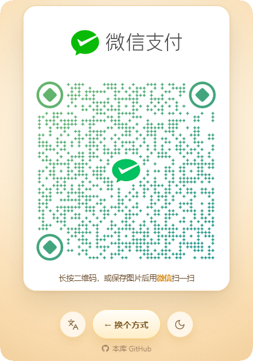
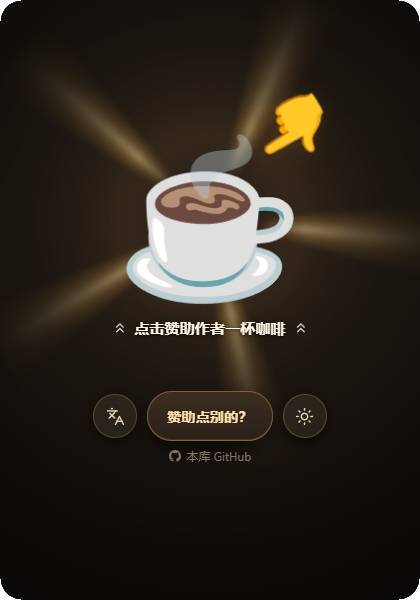
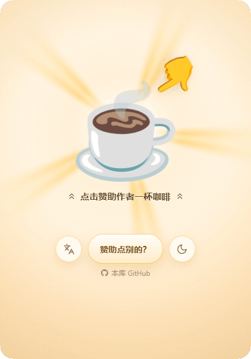
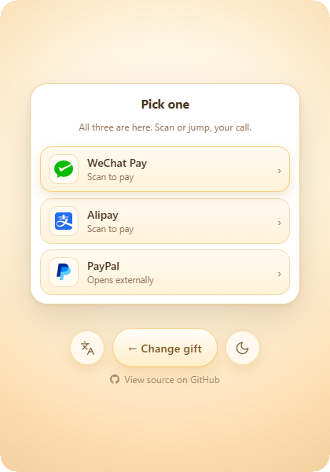
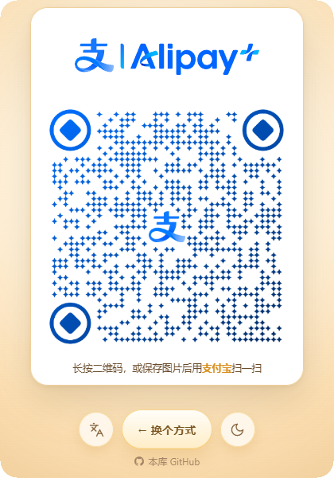
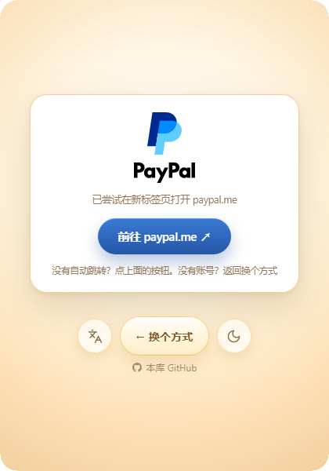

<div align="center">
    <h1>sponsor-me</h1>
    <p>一个不用构建的单页赞助页 · 深浅双主题 · 中英双语 · 微信 / 支付宝 / PayPal</p>
    <p><b>中文</b> | <a href="README-en.md">English</a></p>
    <p>
        <a href="https://github.com/JH0531/sponsor-me/blob/main/LICENSE"></a>
        <a href="https://github.com/JH0531/sponsor-me/graphs/contributors"></a>
        <a href="https://github.com/JH0531/sponsor-me/releases"></a>
        <a href="https://github.com/JH0531/sponsor-me/stargazers"></a>
        <a href="https://www.jsdelivr.com/package/gh/JH0531/sponsor-me"></a>
    </p>
</div>

## 演示

### 三个界面

入口、渠道选择、收款卡都在同一个页面里切换，没有路由、跳转或重载。

<p align="center">
    
    
    
</p>

### 礼物切换

点「赞助点别的？」会在礼物池里换一个，动画和文案一起换。

<p align="center"></p>

### 明暗双主题

按系统偏好自动选择，也可以点右下角按钮手动切换；切换时以按钮为圆心展开圆形遮罩。

<p align="center">
    
    
    
</p>

### 中英双语

入口文案、礼物、弹幕、渠道名和无障碍标签都随语言切换；`zh-*` 一律走简体，其余走英文。

<p align="center">
    
    
    
</p>

### 支付渠道

微信支付和支付宝给出收款二维码；PayPal 打开外部链接，页面同时留一张承接卡，方便没自动跳转或没有账号时返回。

<p align="center">
    
    
    
</p>

### 完整流程

入口 → 礼物切换 → 语言切换 → 主题切换 → 礼花 → 微信 → 支付宝 → PayPal 外部跳转与返回 → 收尾。

<div align="center">
    <video src="https://github.com/user-attachments/assets/936af679-87d0-4795-a3c1-42c559bbdcfd" controls width="420" style="border-radius:10px"></video>
</div>

<p align="center"><a href="docs/demo/journey-v2.mp4">完整流程视频</a></p>

## 特性

- **一个页面三种界面**：入口 / 渠道选择 / 收款卡，靠 `data-state` + `channel` 切换，无路由
- **矢量动画**：Noto Animated Emoji 的 Lottie，任意分辨率都不糊
- **深浅双主题 + 中英双语**：按系统偏好自动路由，也能手动切
- **双击就能跑**：`index.html` 直接打开即可，不需要构建

## 快速开始

```bash
# 直接双击 index.html。或者起个静态服务器：
python -m http.server 8000
```

## 改这一个文件就能用

全部在 `assets/config.js`。

### 1. 收款信息

```js
meta: {
  paypalUrl: 'https://paypal.me/<your ID>'
}
```

二维码直接覆盖 `assets/qr/` 里的四个文件（微信 / 支付宝 × 深 / 浅）。原图 500×500，保持方形、保留白边。

### 2. 礼物条目

`media` 是媒体注册表，key 就是文件名，全局唯一：

```js
media: {
  hero:  { file: 'coffee.json', kind: 'lottie', loop: 2017 },
  socks: { file: 'socks.json',  kind: 'lottie', loop: 2200 }
}
```

- `file` 指向 `.media/lottie/` 下的原始 Lottie JSON（该目录不进仓库，见下文）
- `kind` 目前都是 `'lottie'`
- `loop` 是一轮动画的毫秒数，构建脚本会拿它和 JSON 自身的 `(op-ip)/fr` 核对
- `trim`（可选）把时间轴裁到第几帧，用来去掉尾部的空白或重复循环

**停止帧不用你管。** Noto 的每份 Lottie 都带一个 `rest` 标记，指出作者认为
"该停在哪一帧"，构建脚本会自动读出来，和动画一起下发到 `window.__LOTTIE_REST__`。
这很重要——有些动画第 0 帧是空白（🌈 / 🍦），有些是侧视（🍪 正好转到 90°），
有些只有一粒火星（🌟）。一律停在第 0 帧的话，画面会卡在认不出是什么的位置。

`trim` 目前用在两处，都是源动画自身的毛病：

| key | 问题 | 处理 |
| --- | --- | --- |
| `rocket` | 40 帧其实是两遍完全相同的 20 帧，整段播会看到动作重复一遍，第 40 帧还是空白 | `trim: 20`，`loop: 333` |
| `cookie` | 第 106 帧之后到结尾全是空白，会多出 200ms 空画面 | `trim: 106`，`loop: 1767` |

`items` 按语言分组，靠 `media` 名跨语言匹配：

```js
items: {
  'zh-Hans': [ { media: 'hero', caption: '点击赞助作者一杯咖啡', blurb: '' } ],
  'en':      [ { media: 'hero', caption: 'Tap to buy the author a coffee', blurb: '' } ]
}
```

`caption` 里不要写箭头符号——两侧的 `chevrons-up` 图标由渲染层插入，跟随文字颜色。

**每种语言是独立的**。某个礼物只想在中文里出现，不写进 `en` 列表即可——切到英文时如果当前物品在英文里没有同名条目，会自动换成第一条。

### 3. 弹幕与界面文案

`danmaku` 按语言分组；`i18n` 放按钮、提示、无障碍标签。

## 重新生成素材（可选）

```bash
node scripts/build-assets.mjs
```

纯 Node，不需要 ffmpeg / ImageMagick。脚本读 `assets/config.js`，把 `.media/` 里的构建输入转成 `assets/` 下的运行时资源：

| 输入（`.media/`，不进仓库） | 输出（`assets/`，随仓库） |
| --- | --- |
| `lottie/*.json` | `lottie/<key>.js` — 包成 `window.__LOTTIE__` 注册 |
| `vendor/lottie_light.min.js` | `vendor/lottie_light.min.js` |
| `修改源材料/*.svg` | `brand/*.svg` |
| `修改源材料/*收款码*.png` | `qr/*.png` |

> Lottie 之所以包成 `.js` 而不是留 `.json`：`lottie-web` 用 XHR 读 `path`，
> `file://` 下会被 CORS 拦掉。包成脚本用 `<script>` 加载，双击 `index.html` 也能跑。

### 关于 `.media/`

它是**本机的构建输入目录，被 `.gitignore` 的 `/.*/` 排除**，不会随仓库上传。
里面放 Lottie 原始 JSON、渠道品牌 SVG、收款二维码原图，以及一份 `sources.md` 记录每份素材的出处。
换台机器要重建素材，得先按 `sources.md` 把这个目录补齐。

## 外部依赖

| 依赖 | 版本 | 用途 | 授权 |
| --- | --- | --- | --- |
| [lottie-web](https://github.com/airbnb/lottie-web) | 5.12.2（`lottie_light`，SVG 渲染器） | 播放 Lottie 动画，已内联在 `assets/vendor/` | MIT |

运行时没有其它第三方依赖，也没有 CDN 请求。构建脚本只用 Node 内置模块。

## 兼容性

Lottie 走 SVG 渲染，主流浏览器表现一致；没有编解码、alpha 通道之类的分支。
动画数据用 `<script>` 动态加载，所以 `file://` 与 http 都能用。

> 唯一的差别：个别浏览器在 `file://` 下对 `localStorage` 限制更严，
> 主题 / 语言偏好可能记不住，会退回按系统偏好自动判断。

## 结构

```
index.html                唯一入口
README.md                 中文说明
README-en.md              英文说明
assets/
  config.js               媒体注册表 + 多语言条目 + 弹幕 + 渠道 + 文案
  styles.css              双主题令牌 + 布局 + 动画
  app.js                  主题 / 语言 / Lottie 播放 / 状态机 / 礼花 / 弹幕
  lottie/ vendor/ brand/ qr/ emoji/
docs/demo/                README 演示素材
scripts/                  素材构建、演示录制、deploy 同步
.github/workflows/deploy-sync.yml
LICENSE                   GPL-3.0
```

### 状态机

| 状态 | 触发 | 去向 |
| --- | --- | --- |
| `idle` | 点热饮 | `launching` → 2000ms 后 `channel` |
| `idle` | 点「赞助点别的？」 | `rolling` → 900ms 后回 `idle` |
| `channel` | 点渠道 | 停在 `channel`，只换卡片 |
| `channel` | 主按钮 | 选择页 → 回 `idle`（保留当前礼物）；二维码页 → 回选择页 |

底部那颗主按钮是复用的：文案和行为随状态变，所以三个界面都只有一颗。
每次进入打赏页都是全新的入场动画——回退时会清掉卡片状态，不会先播一遍退场。

### 主题与语言

- 主题：读 `prefers-color-scheme`，读不到 fallback 到 light。手动切换用 View Transitions 做「以按钮为圆心的圆形遮罩」，不支持的浏览器直接换。
- 语言：所有 `zh-*` 语言标签统一走简体，其他一律英文。
- 两者都写进 `localStorage`，手动选过就优先用选过的。

### deploy 分支与同步

`deploy` 是纯部署分支，白名单只有 `index.html`、`assets/**`、`LICENSE`。README、`docs/demo/`、脚本、`.github/`、站点验证文件，以及 main 今后新增的任何文件，都不会进入。

`deploy` 保持线性历史：每次同步以当前 deploy HEAD 为父提交，用普通快进推送；内容无变化时不产生提交。

```bash
node scripts/sync-deploy.mjs --dry-run    # 打印清单并断言
node scripts/sync-deploy.mjs --push       # 生成并快进推送
node scripts/sync-deploy.mjs --verify     # 校验远端纯净
```

脚本只读提交树、用仓库外的临时索引组装，不碰工作区、未跟踪文件或 stash；`.github/workflows/deploy-sync.yml` 会在 main 的部署相关文件变更时自动同步。

| 改动 | 对 deploy 的影响 |
| --- | --- |
| `index.html` / `assets/**` | 自动同步 |
| README / `docs/demo/` | 天然排除 |
| 新增礼物动画 `assets/lottie/*.js` | 落在 `assets/**`，自动同步 |

回滚用 `node scripts/sync-deploy.mjs --push --from <good-sha>`：从指定 main 提交重建内容，仍以当前 deploy HEAD 为父提交生成回滚提交，不改写历史。

### 版本发布

`release` 从 `deploy` 分叉，是人工发版闸门；它不产生自己的提交，每次同步都是快进。

```bash
node scripts/sync-release.mjs --dry-run   # 检查可否快进
node scripts/sync-release.mjs --push      # 快进 release，触发自动发版
node scripts/next-version.mjs             # 预览下一个版本号
```

推送到 release 后，`.github/workflows/release.yml` 自动创建 tag 与 GitHub Release，并上传 zip / tar.gz 与 SHA256SUMS。版本号以 `V` 开头的 tag 为唯一事实源：初版 `V0.1.0`，第三段逢 10 进 1 到第二段，第二段逢 100 进 1 到首段，首段不设上限。也可通过 workflow_dispatch 的 dry run 预览而不发布。

## 无障碍与降级

- `prefers-reduced-motion`：关掉旋转、礼花、弹幕滚动，改成一行固定文案；点热饮后 200ms 直达打赏页
- 触屏没有 hover：热饮每 6 秒自己播一轮
- 所有覆盖层 `pointer-events: none`，二维码可正常长按识别

## 致谢

- [qr-merger/merger](https://github.com/qr-merger/merger) — 轻量的一体化收款码页面，支持微信、支付宝、PayPal 与多语言；本项目的渠道整合思路参考自它。
- [kimi360/Docker-Sponsor-Page](https://github.com/kimi360/Docker-Sponsor-Page) — 含支付宝 / 微信赞助按钮的 Docker 镜像，提供翻转卡片与「打赏咖啡」两套样式；本项目的卡片交互参考自它。

## 许可

本项目代码以 **GNU General Public License v3.0** 发布，全文见 [LICENSE](LICENSE)。

### 动画素材

页面里的 emoji 动画来自 **[Noto Animated Emoji](https://googlefonts.github.io/noto-emoji-animation/)**（Google），
以 **[CC BY 4.0](https://creativecommons.org/licenses/by/4.0/)** 授权使用。
文件位于 `assets/lottie/`，由 `.media/lottie/` 下的原始 JSON 构建而来，未对画面内容做修改。

> Noto Animated Emoji © Google, licensed under CC BY 4.0.

用到的 emoji（共 33 项）：

| 组 | emoji |
| --- | --- |
| 入口与手势 | ☕ 👇 |
| 心意 | 💝 💋 💐 🎈 🌈 🍀 🌟 |
| 吃喝 | 🍻 🧋 🍹 🍪 🍦 🍗 🔥 |
| 奖励 | 🏆 🥇 💯 💎 🪙 💸 |
| 玩物 | 🎰 🔮 🪄 🛸 🏠 🚀 |
| 其它 | 💣 👻 💡 📣 🧦 |

### 渠道标识

`assets/brand/` 下的微信支付、支付宝、PayPal 标识，其商标权归各自权利人所有，
此处仅用于标识对应的支付渠道，不构成任何关联或背书。

### 第三方库

`assets/vendor/lottie_light.min.js` 为 [lottie-web](https://github.com/airbnb/lottie-web) 官方构建，
以 MIT 授权使用，文件内保留其原始版权声明。
